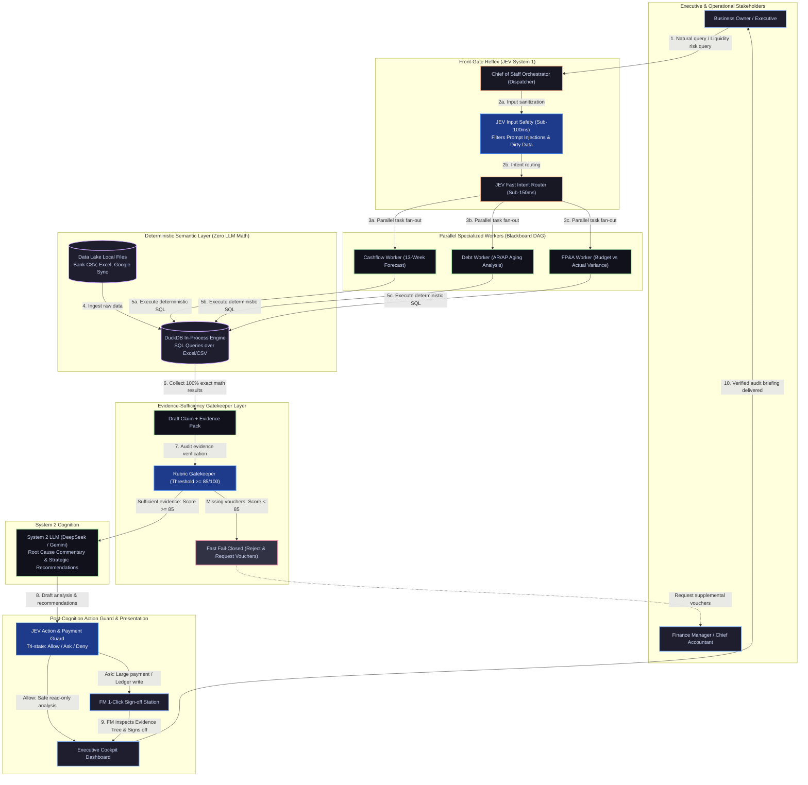

# FinESO Architecture — 01. Concept Diagram

> **Document Code:** `SDLC-ARCH-C4-01-CONCEPT`  
> **Architecture Level:** Conceptual Architecture & Operational Core Flow (Dual-System Cognition)  
> **Navigation:** [← Return to Landscape Hub](./README.md) · [Next: 02. System Context C4-L1 →](./02.system-context-c4-l1.md) · [JEV Scenarios Playbook: 06. JEV Scenarios →](./06.jev-agentic-scenarios.md)  
> **Graphics Standard:** x79 Catppuccin Golden Reference (`fineso.doc.mermaid.md`)

---

## 1. Core Operational Philosophy

**FinESO** operates under the inviolable principle:
> **"No Evidence $\to$ No Claim"**  
> *Zero unverified assertions $\to$ Strictly forbidden from reaching the executive dashboard.*

To eliminate the 5 fatal pitfalls of financial AI (arithmetic hallucinations, sequential latency, lagging ledgers, defensive finance managers, and group chat token explosions), FinESO structures its operational loop using **Dual-System Cognition (Daniel Kahneman)**:
1. **System 1 (TypeSafe JEV Subsystem):** Instant reflex engine ($100-200\text{ms}$) consuming near-zero tokens. Guards both endpoints: sanitizes raw inputs against prompt injections, routes intent, preflights evidence completeness, and guards financial actions/disbursements before human sign-off.
2. **Deterministic Semantic Engine (DuckDB SQL):** Queries raw data files (Excel, CSV, Parquet) in `data-lake/` directly. **100% of arithmetic calculations are executed by DuckDB**, strictly forbidding LLMs from mental math in context.
3. **Automated Rubric Gatekeeper & Sign-off:** Draft claim metrics must be linked to source cell coordinates or bank transaction IDs and achieve Rubric Score $\ge 85/100$ before System 2 LLM (DeepSeek) is permitted to write commentary, concluding at the FM 1-Click Sign-off Station.

---

## 2. Concept Diagram

---

## 3. Step-by-Step Execution Lifecycle

1. **Step 1 (User Query):** Business Owner queries cash position (e.g., *"Do we have sufficient cash to settle the supplier invoice on the 25th?"*).
2. **Step 2 (Input Safety & Fast Routing):** `JevSafety` screens input against prompt injection in sub-100ms; `TaskRouter` classifies target domain via Typed Schema Questions in sub-120ms.
3. **Step 3 (DAG Fan-Out):** Specialized Workers (Cashflow, Debt, FP&A) are fanned out concurrently in a Blackboard DAG; unconstrained peer chat is strictly prohibited.
4. **Steps 4 & 5 (Deterministic SQL):** Workers generate parameterized SQL and invoke the in-process DuckDB engine directly over bank statements and receivables ledgers.
5. **Step 6 (Evidence Assembly):** DuckDB returns mathematically exact recordsets, assembling a draft `EvidencePack` with cell and row coordinate traces.
6. **Step 7 (Rubric Preflight Evaluation):** `RubricGate` scores the pack across 4 dimensions (Authenticity, Reconciliation, Coverage, Freshness).
   - If $\text{Score} < 85$: Fast Fail-Closed triggers immediately, alerting the FM to supply missing vouchers and saving 100% of downstream LLM tokens.
   - If $\text{Score} \ge 85$: Promoted to System 2.
7. **Step 8 (Insight Synthesis & Action Guard):** DeepSeek interprets root causes; the draft is evaluated by `JevActionGuard` against enterprise policy thresholds.
8. **Step 9 (Human-in-the-loop Sign-off):** If disbursements $> 50\text{M VND}$ or ledger writes are proposed, JEV requires the FM to inspect the Evidence Tree and execute **1-Click Sign-off**.
9. **Step 10 (Executive Delivery):** The verified briefing is rendered on the Executive Cockpit Dashboard with full SHA-256 audit seal.
