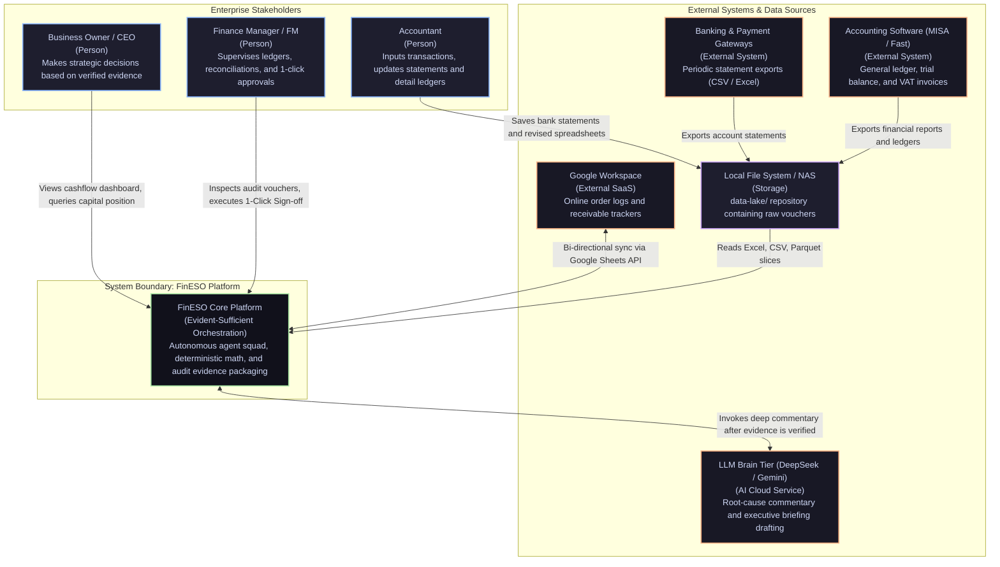

# FinESO Architecture — 02. System Context Diagram (C4 Model — Level 1)

> **Document Code:** `SDLC-ARCH-C4-02-CONTEXT`  
> **Architecture Level:** C4 Level 1 — System Context Diagram  
> **Navigation:** [← 01. Concept Diagram](./01.concept-diagram.md) · [Landscape Hub Index](./README.md) · [Next: 03. Container Diagram C4-L2 →](./03.container-diagram-c4-l2.md) · [JEV Scenarios Playbook: 06. JEV Scenarios →](./06.jev-agentic-scenarios.md)  
> **Graphics Standard:** x79 Catppuccin Golden Reference (`fineso.doc.mermaid.md`)

---

## 1. System Boundary Scope

The System Context diagram positions the **FinESO** platform within the enterprise's organizational and technological ecosystem. Within the FinESO boundary, the system operates with **Dual-System Cognition**: the ultra-fast **TypeSafe JEV (System 1)** reflex engine enforces 9 financial safety touchpoints, pairing with **DeepSeek/Gemini (System 2)** for semantic reasoning once numbers are proven with deterministic evidence:
- **Internal Stakeholders:**
  - **Business Owner / CEO:** Consumes executive dashboards, queries real-time net liquidity positions, and inspects projected cash cliffs.
  - **Finance Manager (FM / Chief Accountant):** Acts as the final human gatekeeper, inspecting audit vouchers and authorizing actions via the 1-Click Sign-off Station.
  - **Accountant:** Maintains raw bank statement exports and reconciliation spreadsheets within the `data-lake/` repository.
- **External Systems & Data Sources:**
  - **Banking & Payment Gateways:** Provides periodic statement exports (CSV / Excel).
  - **Google Workspace (Sheets API):** Enables bi-directional synchronization with online order logs and receivables trackers.
  - **Accounting Software (MISA / Fast):** Supplies official ledger exports, financial reports, and VAT invoice databases.
  - **LLM Brain Tier (DeepSeek / Gemini Cloud):** High-reasoning AI services used strictly to interpret root causes after evidence passes rubric audit gates.
  - **Local Storage / NAS:** The local `data-lake/` filesystem storing physical spreadsheets and statement files on-premise.

---

## 2. System Context Diagram

---

## 3. Architecture Breakthroughs

1. **Zero-Disruption Integration (Preserving Existing Software):**
   - Most SMEs cannot rip and replace legacy software (MISA, Fast) or abandon established spreadsheet routines. FinESO integrates at the file layer via `data-lake/`, respecting existing operational habits.
2. **Local-First Security (Shielding Sensitive Financial Data):**
   - Raw transaction ledgers remain on local enterprise storage. Only compact, PII-masked, aggregated JSON slices are transmitted to cloud LLMs for qualitative synthesis.
3. **Clear Human vs. AI Authority Boundaries:**
   - AI Agents are restricted to read-only queries, deterministic math, and draft generation. Authority to alter general ledgers, initiate wire transfers, or release executive reports **remains exclusively with human leaders (Finance Manager & Business Owner)**.
