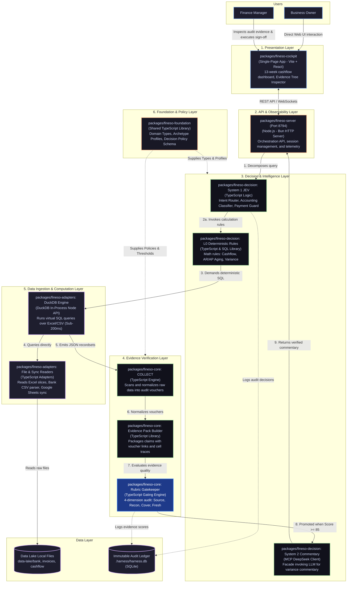

# FinESO Architecture — 03. Container Diagram (C4 Model — Level 2)

> **Document Code:** `SDLC-ARCH-C4-03-CONTAINER`  
> **Architecture Level:** C4 Level 2 — Container Diagram  
> **Navigation:** [← 02. System Context C4-L1](./02.system-context-c4-l1.md) · [Landscape Hub Index](./README.md) · [Next: 04. JEV Component C4-L3 →](./04.jev-component-diagram-c4-l3.md) · [JEV Scenarios Playbook: 06. JEV Scenarios →](./06.jev-agentic-scenarios.md)  
> **Graphics Standard:** x79 Catppuccin Golden Reference (`fineso.doc.mermaid.md`)

---

## 1. Monorepo Container Breakdown

The **FinESO** platform is packaged as a high-performance Monorepo comprising 5 core packages mapping to 5 operational containers:
1. **`fineso-cockpit` (Presentation Layer):** Single-Page Application built with React and Vite, delivering the 13-week cashflow dashboard, interactive graphs, and the Interactive Evidence Tree Inspector.
2. **`fineso-server` (API & Host Layer):** HTTP Server running on Node.js / Bun runtime on port `:8794`, orchestrating client requests, session lifecycles, and telemetry.
3. **`fineso-decision` (Decision & Intelligence Layer):** Dual-System cognition engine hosting the TypeSafe JEV System 1 spine (sub-150ms) executing **9 Intervention Touchpoints** (Routing, Input Safety, Tool Guard, Triage, Reranking, Output Eval, Batch Tagging, Real-time Tick, Confidence Gate), the L0 deterministic rule library, and System 2 LLM Facade.
4. **`fineso-core` (Evidence Verification Layer):** Data harvesting module (`COLLECT`), structured evidence packaging (`EvidencePackBuilder`), and the Automated Rubric Gatekeeper ($\ge 85/100$).
5. **`fineso-adapters` (Data Ingestion & Computation Layer):** In-process DuckDB engine executing ultra-fast SQL over Excel/CSV files ($< 200\text{ms}$) and Google Sheets API sync adapters.
6. **`fineso-foundation` (Foundation & Policy Layer):** Shared TypeScript domain types, 4 enterprise Archetype Profiles, and safety governance configuration `decision-policy.json`.

---

## 2. Container Diagram

---

## 3. Internal Data Flow Cycle

1. **Web Query Intake:** User queries via `fineso-cockpit` to `fineso-server`.
2. **JEV Reflex Trigger:** `fineso-server` hands request to `JevEngine` in `fineso-decision`.
3. **L0 Rule Invocation:** `JevEngine` parses intent and invokes corresponding deterministic financial rules in `L0Rules`.
4. **DuckDB Querying:** `L0Rules` emits SQL queries down to `DuckDBAdapter` to scan files in `data-lake/`.
5. **Evidence Aggregation:** Mathematically exact results are forwarded to `fineso-core` to assemble the structured `EvidencePack` with cell traces.
6. **Rubric Gate Verification:** `RubricGate` scores audit sufficiency. Only when $\text{Score} \ge 85/100$ is the pack delivered to `LLMFacade` for DeepSeek commentary synthesis.
7. **Immutable Audit Hashing:** `JevEngine` and `RubricGate` concurrently hash decisions with SHA-256 and commit entries into `AuditLedger` (.harness/harness.db).
