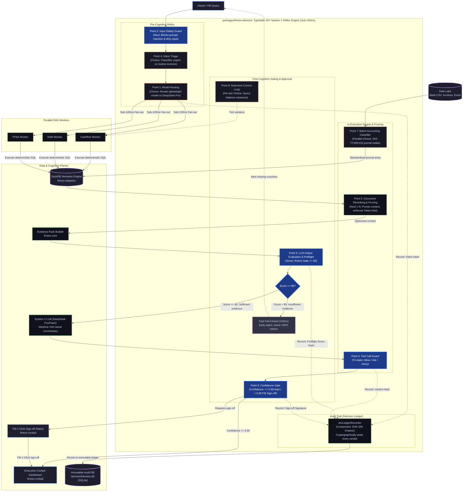

# FinESO Architecture — 04. JEV Component Diagram (C4 Model — Level 3)

> **Document ID:** `SDLC-ARCH-C4-04-JEV-COMPONENT`  
> **Architecture Level:** C4 Level 3 — Component Diagram (TypeSafe JEV Reflex Subsystem)  
> **Navigation:** [← 03. Container Diagram C4-L2](./03.container-diagram-c4-l2.md) · [Landscape Hub Index](./README.md) · [Next: 05. Packages Matrix & Invariants →](./05.packages-matrix-and-invariants.md) · [Operational Scenarios: 06. JEV Scenarios →](./06.jev-agentic-scenarios.md)  
> **Visual Standard:** x79 Catppuccin Golden Reference (`fineso.doc.mermaid.md`)

---

## 1. Essence & Mission of the TypeSafe JEV Subsystem (System 1)

Within the FinESO platform, **JEV (TypeSafe Jev)** is not a solitary function, but an integrated **System 1 Reflex Subsystem** located inside [`packages/fineso-decision`](file:///Users/thangs2net/Workspaces/FinESO/packages/fineso-decision):
- **Reflex Velocity:** $100 - 200\text{ms}$ (contrasting with $3 - 8\text{s}$ for System 2 LLMs).
- **Operating Cost:** Token consumption $\approx 0$, utilizing typed schema questions (`Choice`, `Noul`, `Score`, `Confidence`).
- **Vital Mission:** Deeply embedded across the **9 Intervention Touchpoints** of the Agentic Loop, rigorously guaranteeing the 5 Sacred Invariants (specifically Invariant 1: *No Evidence $\to$ No Claim*, Invariant 2: *Deterministic Math*, Invariant 3: *Token-Diet / Deny Raw Excel Dump*, and Invariant 4: *Rubric Gate $\ge 85$*).

---

## 2. JEV Subsystem Component Diagram (C4 Level 3 Component Diagram)

---

## 3. 9 Intervention Touchpoints Mapping to JEV Components

| Logic Block | Intervention Touchpoint | Technical Component | Jev Verdict Type | Processing Latency & Business Impact |
| :--- | :---: | :--- | :--- | :--- |
| **Pre-Cognition** | **1** | `JevIntentRouter` | `Choice` | Sub-120ms: Fan-out DAG tasks to workers without burning heavy LLM tokens. |
| | **2** | `JevSafetyGuard` | `Noul` | Sub-100ms: Evaluates toxicity and blocks prompt injections from dirty vouchers/bank statements. |
| | **4** | `JevInboxTriage` | `Choice` | Sub-120ms: Priority triage of vouchers (instant reply / archive / escalate to FM). |
| **In-Execution & Pruning** | **3** | `JevToolGuard` | `Choice` (`allow/ask/deny`) | Sub-150ms: Intercepts dangerous shell/DB commands; escalates expenditures $> 50\text{M}$ VND to FM. |
| | **5** | `JevContextPruner` | `Noul x N` | Sub-200ms: Evaluates 30 contract clauses/regulations, extracts the 2 most relevant (Token-Diet). |
| | **7** | `JevAccountingClassifier` | `Parallel Choice` | Sub-300ms: Classifies VAS TT200/133 accounts in batch across thousands of statement lines. |
| **Post-Cognition & Gating** | **6** | `JevEvidencePreflight` | `Score` | Sub-150ms: Audits output structure and validates Rubric Gate $\ge 85/100$, triggering Fast Fail-Closed if deficient. |
| | **8** | `JevRealtimeTick` | `Per-tick Choice` | Sub-100ms: Captures bank webhook events, automatically triggering rolling cashflow recalculations. |
| | **9** | `JevConfidenceGate` | `Confidence` | Sub-120ms: Autonomy threshold gate ($>0.90$ auto-commit; $0.50-0.90$ pending FM review; $<0.50$ error alert). |
| **Audit Trail** *(Decision Ledger)* | **—** | `JevLedgerRecorder` | `SHA-256 Hash Chainer` | Sub-50ms: Cryptographically records immutable audit trail for tax and regulatory inspections. |

---

## 4. Operational Scenario Execution Details

For comprehensive architectural breakdowns and sequence execution across all 5 operational financial scenarios (13-Week Cashflow Forecast, VAS TT200 Reconciliation, Owner Capital Withdrawal Gate, Ghost Invoice Defense, E-Commerce Platform Settlement), please refer to:  
👉 [**SDLC/04.architecture/01.landscape/06.jev-agentic-scenarios.md**](./06.jev-agentic-scenarios.md).
