# FinESO Architecture — 05. Packages Matrix & Invariants Guarantee

> **Document ID:** `SDLC-ARCH-C4-05-MATRIX-INVARIANTS`  
> **Architecture Level:** Responsibility Matrix & Invariants Enforcement  
> **Navigation:** [← 04. JEV Component C4-L3](./04.jev-component-diagram-c4-l3.md) · [Landscape Hub Index](./README.md) · [Next: 06. JEV Agentic Scenarios →](./06.jev-agentic-scenarios.md)  
> **Visual Standard:** x79 Catppuccin Golden Reference (`fineso.doc.mermaid.md`)

---

## 1. Internal Packages Separation of Concerns Matrix

| Package | NPM Identifier | Technical Role | Inputs | Outputs |
| :--- | :--- | :--- | :--- | :--- |
| **`fineso-foundation`** | `@fineso/foundation` | Base schemas, domain types, profiles, decision policies. | None (Root domain definitions). | TypeScript types, validated policy JSON. |
| **`fineso-adapters`** | `@fineso/adapters` | DuckDB connectors, slice-based Excel/CSV readers, Google Sheets sync. | Raw files in `data-lake/` (`.xlsx`, `.csv`). | Standardized JSON recordsets. |
| **`fineso-core`** | `@fineso/core` | Voucher collection, Evidence Pack construction, Rubric Gate $\ge 85$ evaluation. | Recordsets from `adapters`, audit standards. | Evidence Packs with digital signatures & rubric scores. |
| **`fineso-decision`** | `@fineso/decision` | **TypeSafe JEV Subsystem (5 Modules)** + L0 Rules + System 2 LLM Facade. | Evidence Packs from `core`, user queries. | Verified financial reports with audited variance commentary. |
| **`fineso-cockpit`** | `@fineso/cockpit` | Single-Page Application (React/Vite) rendering cashflow & evidence trees. | APIs from `fineso-server`. | Interactive dashboard UI for Business Owners and FMs. |

---

## 2. Guaranteeing the Five Sacred Invariants

FinESO's multi-tier architecture enforces the 5 Sacred Invariants without compromise:

```mermaid
flowchart LR
    classDef client fill:#1e1e2e,stroke:#89b4fa,stroke-width:2px,color:#cdd6f4;
    classDef edge fill:#181825,stroke:#fab387,stroke-width:2px,color:#cdd6f4;
    classDef service fill:#11111b,stroke:#a6e3a1,stroke-width:2px,color:#cdd6f4;
    classDef data fill:#1e1e2e,stroke:#cba6f7,stroke-width:2px,color:#cdd6f4;
    classDef statusGate fill:#1e3a8a,stroke:#3b82f6,stroke-width:2px,color:#ffffff;

    Inv1["Invariant 1: No Evidence No Claim<br/>(Evidence Pack Builder)"]:::statusGate
    Inv2["Invariant 2: Deterministic Math<br/>(DuckDB SQL Engine)"]:::data
    Inv3["Invariant 3: Deny Raw Excel Dump<br/>(Slice-Reading Adapter)"]:::service
    Inv4["Invariant 4: Rubric Gate >= 85<br/>(Fail-Closed Preflight)"]:::statusGate
    Inv5["Invariant 5: Dual-Harness Isolation<br/>(.cursor vs .agents)"]:::edge

    Inv1 --> Inv2
    Inv2 --> Inv3
    Inv3 --> Inv4
    Inv4 --> Inv5
```

### Detailed Invariant Specifications:

1. **Invariant 1 (No Evidence $\to$ No Claim):**
   - Every metric and figure presented in reports to the Business Owner must tie directly to at least one `evidence_item` (e.g., cell coordinates `Sheet1!D15`, bank transaction ID, or e-invoice code).
   - Unsubstantiated qualitative statements are strictly prohibited.
2. **Invariant 2 (Deterministic Calculator vs. Probabilistic LLM):**
   - All arithmetic, cumulative balances, aging brackets, and variance computations must be executed via **deterministic DuckDB / SQL / Python functions**.
   - LLMs are strictly forbidden from performing mental math in context.
3. **Invariant 3 (Deny Raw Excel Dump / Token-Diet):**
   - Never load entire thousand-line Excel or CSV files into the LLM context using `view_file`.
   - All queries must be executed via the DuckDB engine or through targeted slice reading.
4. **Invariant 4 (Rubric Gate $\ge 85$):**
   - Reports are released only when the total Evidence-Sufficiency Score reaches $85/100$ or higher across 4 dimensions (Source Authenticity, Deterministic Reconciliation, Period Coverage, Data Freshness).
   - Incomplete data triggers an immediate Fast Fail-Closed routine requesting missing vouchers.
5. **Invariant 5 (Dual-Harness Isolation — Cursor vs. Antigravity):**
   - The `.cursor/` directory is an isolated environment dedicated exclusively to **Cursor IDE** (`.mdc` format).
   - The `.agents/` directory is an isolated environment dedicated exclusively to **Google Antigravity IDE** (`.md` format).
   - Deleting, merging, or cross-converting files between these two directory trees is strictly prohibited.
