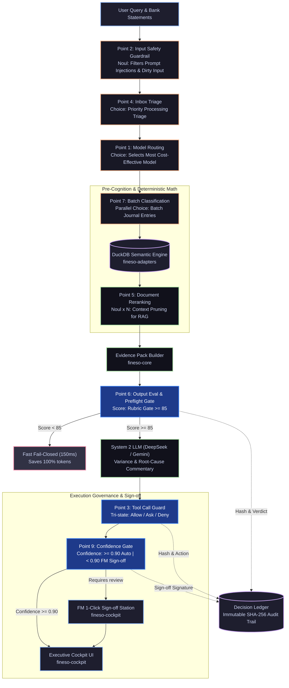
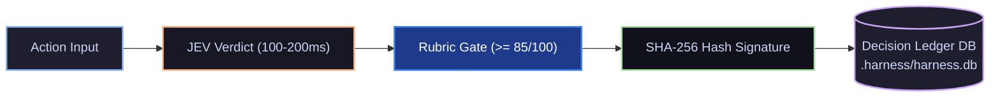

# FinESO Architecture — 06. JEV Agentic Scenarios & Operational Playbook

> **Document ID:** `SDLC-ARCH-C4-06-JEV-AGENTIC-SCENARIOS`  
> **Architecture Level:** Operational Architecture — Production Scenario Playbook & 9 JEV Intervention Touchpoints  
> **Navigation:** [← 05. Packages Matrix & Invariants](./05.packages-matrix-and-invariants.md) · [Landscape Hub Index](./README.md)  
> **Visual Standard:** x79 Catppuccin Golden Reference (`fineso.doc.mermaid.md`)

---

## 1. Architectural Vision: JEV as the Agent's Reflexive Nervous System

Within the FinESO platform, **JEV (TypeSafe Jev)** functions as the **Sub-150ms Reflexive Nervous System (Kahneman System 1 Reflex Subsystem)** operating concurrently alongside the **Deep Analytical Reasoning Engine (System 2 LLM — DeepSeek / Gemini)**.

> **Core Operating Philosophy:**  
> *LLM Proposes (Cognition / Reasoning) $\longrightarrow$ JEV Decides (Typed Fast Verdict / System 1) $\longrightarrow$ Deterministic Code Executes (100% Reproducible).*

Rather than allowing unconstrained LLM execution in mission-critical financial workflows, FinESO embeds JEV into **9 vital intervention touchpoints** across the Agent lifecycle, rigorously guaranteeing the 5 Sacred Invariants:
1. **No Evidence $\to$ No Claim:** JEV pre-evaluates drafts and rejects claims lacking vouchers.
2. **Deterministic Calculator:** JEV offloads all calculations into DuckDB, banning mental math in the LLM context.
3. **Deny Raw Excel Dump:** JEV filters and prunes context, strictly preserving the Token Diet.
4. **Rubric Gate $\ge 85$:** JEV scores output structure before releasing any report to Cockpit.
5. **Dual-Harness Isolation:** Completely isolated configuration pipelines between IDE environments.

---

## 2. Matrix of the 9 JEV Intervention Touchpoints

| Phase | No. | JEV Touchpoint | JEV Data Type | Business Role in FinESO | Responsible Package |
| :--- | :---: | :--- | :--- | :--- | :--- |
| **Pre-Cognition** | **1** | **Model Routing** | `Choice` | Routes routine queries to lightweight/cost-effective models while dispatching complex strategic financial tasks to DeepSeek Pro. | `fineso-decision` |
| | **2** | **Input Safety Guard** | `Noul` | Screens incoming vouchers and anomalous bank statement narratives to neutralize financial prompt injections before ledger ingestion. | `fineso-core` |
| | **4** | **Inbox Triage** | `Choice` | Triages inbound vouchers and emails: immediate settlement, record archive, or escalation to FM for signature. | `fineso-decision` |
| **In-Execution** | **3** | **Tool Call Guard** | `Choice` (`allow/ask/deny`) | Gatekeeps sensitive executions: blocks destructive DB commands; requires FM sign-off for disbursements $> 50\text{M}$ VND. | `fineso-decision` |
| | **5** | **Reranking & Pruning** | `Noul x N` | Filters 30 contract clauses or tax codes down to the top 2 authoritative references, preserving token budget. | `fineso-core` |
| | **7** | **Batch Accounting Classification** | `Parallel Choice` | Classifies thousands of bank transactions in parallel into standard chart of accounts (Accounts 111, 112, 131, 331, 642). | `fineso-decision` |
| **Post-Cognition** | **6** | **LLM Output Preflight** | `Score` | Evaluates report drafts prior to Cockpit display: validates 4-way reconciliation and Rubric Gate $\ge 85/100$. | `fineso-core` |
| | **8** | **Real-Time Control Loop** | `Per-tick Choice` | Continuous bank balance monitoring: triggers instant rolling cashflow recomputations upon balance variance. | `fineso-adapters` |
| | **9** | **Confidence Gate** | `Confidence` | Automated voucher matching: confidence $> 0.90$ auto-drafts entry; $0.50 - 0.90$ prompts FM 1-click review; $< 0.50$ triggers exception alert. | `fineso-decision` |

---

## 3. Dynamic Agentic Decision Flow Architecture

---

## 4. Five Production Financial Engineering Scenarios (Playbook)

### 📈 Scenario 1: 13-Week Cashflow Forecast & Liquidity Deficit Defense
- **Business Challenge:** SME businesses frequently face liquidity crises when expected customer payments are delayed while recurring liabilities disburse automatically.
- **JEV Intervention Touchpoints:** **Point 8 (Real-Time Loop)** + **Point 3 (Tool Call Guard)** + **Point 9 (Confidence Gate)**.
- **Operational Execution:**
  1. *Real-Time Tick:* Triggered by a bank webhook or daily at 07:00 AM, JEV invokes DuckDB to recompute the 13-week rolling forecast.
  2. *Deficit Detection:* If the projected cash balance in Week 3 falls below zero ($< 0$), JEV raises a `critical_liquidity` alert flag.
  3. *Action Guarding:* JEV instantly shifts the `Tool Call Guard` status to `deny` for all non-essential outflows (discretionary capex, advances).
  4. *FM Sign-off:* The LLM formulates a debt restructuring proposal for the Finance Manager; payment thresholds are unblocked only upon FM sign-off.

---

### 📑 Scenario 2: Batch Bank Statement Reconciliation & TT200 Journal Classification
- **Business Challenge:** Thousands of bank statement rows containing unaccented, abbreviated transaction descriptions overwhelm accounting teams.
- **JEV Intervention Touchpoints:** **Point 7 (Batch Tagging)** + **Point 9 (Confidence Gate)**.
- **Operational Execution:**
  1. *Parallel Classification:* JEV processes an array of 2,000 transactions from `data-lake/`, categorizing them across standard accounting accounts in parallel:
     - *"TT tien thue van phong t10"* $\to$ `Account 6422 / Account 1121`.
     - *"CTy ABC thanh toan hop dong 12"* $\to$ `Account 1121 / Account 131`.
  2. *Tri-Level Triage:*
     - `Confidence >= 0.90` (~85% of transactions): Automatically posts draft journal entries into DuckDB.
     - `0.50 <= Confidence < 0.90` (~12% of transactions): Batched into the "FM 1-Click Fast Approval" queue.
     - `Confidence < 0.50` (~3% ambiguous transactions): Routed to the exception reconciliation queue.
  3. *Audit Ledger:* All classifications and confidence ratings are SHA-256 hashed and recorded for tax audit defense.

---

### 🛡️ Scenario 3: Business Owner Capital Withdrawal / Advance Gate
- **Business Challenge:** Business owners frequently request ad-hoc capital withdrawals or excessive advances for personal use, compromising bank debt service obligations.
- **JEV Intervention Touchpoints:** **Point 3 (Tool Call Guard)** + **Point 6 (Output Eval)** + **Point 9 (Confidence Gate)**.
- **Operational Execution:**
  1. *Policy Trigger:* Upon receiving a request: *"Transfer 150M VND from company account to personal account"*:
  2. *Structural Liquidity Check:* JEV commands DuckDB to audit liquidity: will residual cash cover upcoming 14-day AP debt maturities?
  3. *Action Verdict:*
     - If liquidity remains secure: Returns status `ask` (Mandatory FM advance voucher confirmation required).
     - If liquidity buffer is breached: Returns status `deny` with an evidence-backed rationale: *"Withdrawal will trigger a 45M VND cash deficit for bank interest due on October 25"*.

---

### 🔍 Scenario 4: Fraud Detection & Ghost Invoice Defense
- **Business Challenge:** Exposure to invoices from defunct shell companies, pricing manipulation, or duplicate submissions across departments.
- **JEV Intervention Touchpoints:** **Point 2 (Input Safety)** + **Point 5 (Document Rerank)** + **Point 6 (Output Eval)**.
- **Operational Execution:**
  1. *Sanitization:* JEV inspects invoice XML/PDF structures, validating tax code (MST) status and digital signature authenticity.
  2. *Rerank Historical Deals:* JEV queries the 5 most recent transactions for the item in DuckDB to evaluate unit price variance.
  3. *Anomaly Scoring:* If the unit price exceeds $30\%$ above historical median or the supplier tax ID is listed on tax risk registries:
     - JEV assigns safety rating `Noul < 0.20` $\to$ Rejects expense recognition.
     - Triggers an alert in Cockpit mandating FM review of the underlying master contract.

---

### 🛒 Scenario 5: Automated E-Commerce Platform Fee Settlement (Shopee / TikTok Shop)
- **Business Challenge:** Multi-channel retailers receive bulk payouts from e-commerce platforms after deductions across dozens of complex service fees.
- **JEV Intervention Touchpoints:** **Point 7 (Batch Classification)** + **Point 9 (Confidence Gate)**.
- **Operational Execution:**
  1. *Batch Tagging:* JEV ingests weekly settlement files from Shopee/TikTok Shop, automatically decomposing transaction columns:
     - Gross merchandise value $\to$ Recognized Revenue (Account 511).
     - Fixed fees, payment fees, Freeship Xtra fees $\to$ Selling Expenses (Account 641).
     - Platform discount subsidies $\to$ Revenue Deductions / Compensations.
  2. *Deterministic Reconciliation:* DuckDB computes Net Payout and reconciles against the verified bank statement inflow.
  3. *Auto-Reconcile:* If the delta is $\le 1,000\text{ VND}$ (rounding threshold), JEV registers `Confidence = 1.0` and clears the platform receivable account.

---

## 5. Audit Ledger & Closed-Loop Governance (Rubric Gate)

Every JEV determination across the 9 touchpoints strictly satisfies **Invariant 1 & Invariant 4**:

- **Unique Identification:** Every verdict is tagged with a unique `decision_id` and a `SHA-256` hash of all input context.
- **Sub-150ms Response Time:** All 9 touchpoints execute within $\le 150\text{ms}$.
- **Immutable Explainability:** When tax authorities or auditors inspect journal entries or payment denials, the system exports a digitally signed JSON audit bundle replicating the precise state at decision time.
