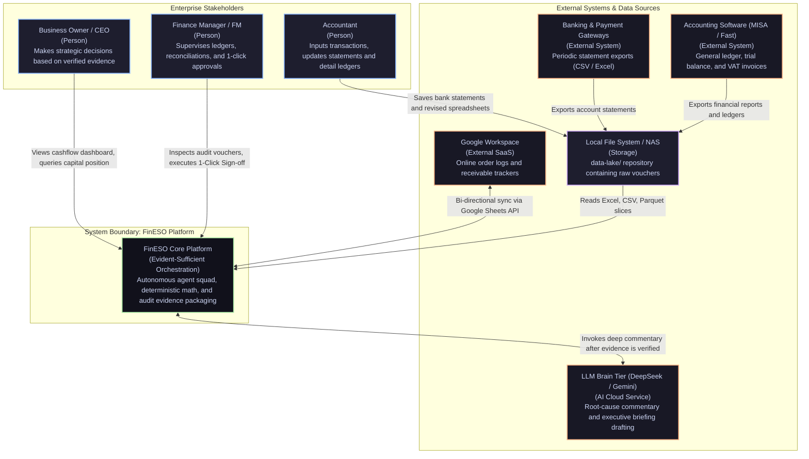

# FinESO — High‑Level Architecture Landscape & Knowledge Hub

> **Document Code:** `SDLC-ARCH-01-LANDSCAPE-HUB`  
> **Project:** FinESO (Financial Evident-Sufficient Orchestration Platform)  
> **Version:** 3.0.0 — Comprehensive Architecture Navigation Hub (C4 Model Levels 1–3)  
> **Graphics Standard:** x79 Catppuccin Golden Reference (`fineso.doc.mermaid.md`)

---

## 1. Vision & Architecture Mission (Architecture Overview)

**FinESO** is an autonomous orchestration platform for a specialized squad of Financial & Accounting AI Agents, operating under the inviolable principle of **Evident-Sufficient Orchestration (ESO)**:
- **Sacred Invariant:** *"No Evidence $\to$ No Claim"* (Every financial claim delivered to executives must be verified by deterministic audit trails).
- **Dual-System Cognition Architecture:**
  - **System 1 (TypeSafe JEV Subsystem):** Instant reflex ($100-200\text{ms}$), near-zero token consumption, executing **9 Intervention Touchpoints** (task routing, safety filtering, payment guarding, context pruning, batch tagging, and confidence gating) and logging immutable audit trails.
  - **System 2 (DeepSeek / Gemini LLM):** Deep semantic reasoning ($3-8\text{s}$), explaining root causes of cashflow variances and proposing strategic initiatives once numbers are verified.
- **3-Tier Separation of Concerns:**
  1. **Evidence Ingestion & Data Lake:** Ingests and queries raw data (Excel, CSV, Google Sheets) directly via the in-process DuckDB engine (`fineso-adapters`); strictly forbids raw spreadsheet dumps in LLM context.
  2. **Deterministic Core & Verification:** Computes 100% mathematically exact numbers, packages Evidence Packs, and validates them via Rubric Gate $\ge 85/100$ (`fineso-core`).
  3. **Decision & Presentation:** Orchestrates workflows via the TypeSafe JEV spine (`fineso-decision`) and presents them on an interactive dashboard with 1-Click Sign-off for the Finance Manager (`fineso-cockpit`).

---

## 2. System Context Diagram (C4 Level 1)

Defines the system boundaries of FinESO with internal enterprise stakeholders and existing third-party software ecosystems:

---

## 3. Architecture Navigation Hub (C4 Model Navigation)

Detailed architectural views and operational playbooks are structured across the C4 Model hierarchy:

| No. | Detailed Document | Decomposition Level | Deliverable Focus |
| :---: | :--- | :--- | :--- |
| **01** | [**`01. Concept Diagram`**](./01.concept-diagram.md) | **Concept** | *"No Evidence $\to$ No Claim"* philosophy, 3-tier separation (Dispatcher $\to$ DuckDB $\to$ Rubric Gate $\ge 85 \to$ FM Sign-off). |
| **02** | [**`02. System Context Diagram`**](./02.system-context-c4-l1.md) | **C4 Level 1** | System boundary of FinESO interacting with users, accounting software, banks, and cloud LLMs. |
| **03** | [**`03. Container Diagram`**](./03.container-diagram-c4-l2.md) | **C4 Level 2** | Monorepo breakdown of 5 packages (`cockpit`, `server`, `decision`, `core`, `adapters`, `foundation`) and internal data flows. |
| **04** | [**`04. JEV Component Diagram`**](./04.jev-component-diagram-c4-l3.md) | **C4 Level 3** | Deep-dive into TypeSafe JEV System 1 (sub-150ms) across 9 Intervention Touchpoints (Pre-Cognition, In-Flight, Post-Cognition). |
| **05** | [**`05. Packages Matrix & Invariants`**](./05.packages-matrix-and-invariants.md) | **Governance** | Inter-package responsibility matrix and enforcement of the 5 Sacred Invariants (Dual-Harness Isolation). |
| **06** | [**`06. JEV Agentic Scenarios`**](./06.jev-agentic-scenarios.md) | **Playbook** | 9 JEV intervention touchpoints applied across 5 real-world SME financial scenarios (Cashflow Deficit, TT200 Reconciliation, Owner Withdrawal, Fraud Defense, E-Commerce Settlement). |

---

## 4. Related Core Blueprints

- 📘 [**SDLC/04.architecture/01.architecture-blueprint.md**](../01.architecture-blueprint.md): Strategic master specification and comprehensive financial domain architecture.
- ⚡ [**SDLC/04.architecture/02.subsystems/01.typesafe-jev-decision-facade.md**](../02.subsystems/01.typesafe-jev-decision-facade.md): Deep architectural specification of TypeSafe JEV System 1.
- 📋 [**SDLC/08.wbs/01.wbs-master-plan.md**](../../08.wbs/01.wbs-master-plan.md): WBS Master Plan spanning Phases 0 through 5.
- ⚖️ [**AGENTS.md**](../../../AGENTS.md): The FinESO Harness manifesto and 5 Sacred Invariants.
