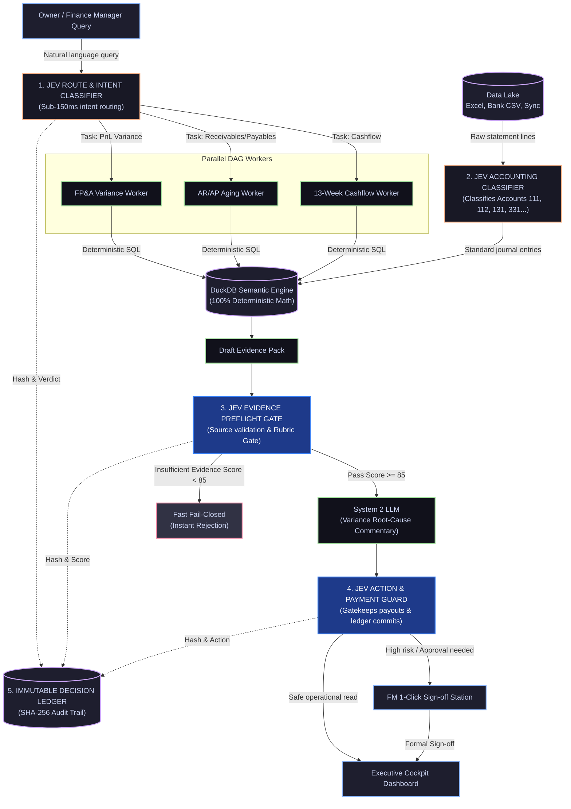

# Detailed Design: TypeSafe Jev (System 1) Integration in FinESO

> **Document ID:** `SDLC-ARCH-02-JEV-TYPESAFE`  
> **Project:** FinESO (Financial Evident-Sufficient Orchestration)  
> **Objective:** Define and architect the deep, comprehensive integration of the **TypeSafe Jev (System 1)** reflex model across financial workflows, evidence verification, and enterprise safety gating.

---

## 1. Business Context & Architectural Motivation

In the foundational architecture blueprint [`01.architecture-blueprint.md`](../01.architecture-blueprint.md), FinESO identifies **5 fatal pitfalls** when deploying AI into corporate finance:
1. *Arithmetic Hallucinations* (Probabilistic LLMs vs. Deterministic Math).
2. *Excessive Latency* (45–90s) caused by sequential chaining and token bloat.
3. *Stale Books & Dirty Data* requiring continuous reconciliation.
4. *Defensive Posture of Finance Managers (FM)* toward unexplainable black-box decisions.
5. *Undisciplined Multi-Agent Group Chats* that dilute the audit context.

### Breakthrough Solution: Dual-System Cognition Architecture
The system integrates two complementary cognitive layers based on Daniel Kahneman's cognitive theory:

```
┌────────────────────────────────────────────────────────────────────────┐
│               DUAL-SYSTEM COGNITION ARCHITECTURE IN FINESO             │
├───────────────────────────────────┬────────────────────────────────────┤
│   SYSTEM 1: TYPESAFE JEV          │   SYSTEM 2: DEEPSEEK / GEMINI      │
│   (Sub-150ms Reflex Subsystem)    │   (Deep Analytical Reasoning)      │
├───────────────────────────────────┼────────────────────────────────────┤
│ • Response Latency: 100 - 200ms   │ • Response Latency: 3 - 15 seconds │
│ • Token Cost: Near Zero           │ • Token Cost: Medium / High        │
│ • Structure: Typed Schema Queries │ • Structure: Free-form Text / JSON │
│ • Responsibilities:               │ • Responsibilities:                │
│   - Intent Classification/Routing │   - In-depth Variance Commentary   │
│   - Risk & Action Guardrails      │   - Strategic Financial Proposals  │
│   - Evidence Preflight Gating     │   - Executive Briefing Drafting    │
│   - Journal Entry Classification  │   - Capital Structure Advisory     │
└───────────────────────────────────┴────────────────────────────────────┘
```

---

## 2. Five Core Focus Areas of Jev in FinESO



---

### Focus Area 1: Intent Routing & DAG Task Decomposition (L2 Decision Facade)
- **Problem Solved:** Eliminates calling expensive, slow LLMs merely to categorize whether a user asks about Cashflow, Debt Aging, or Budget Variance.
- **Jev Mechanism:** Submits the prompt to `/v1/systemone` using Typed Schema Questions:
  ```json
  {
    "model": "jev-latest",
    "state": "Owner query: 'Will projected collections this month cover our debt service due on the 25th?'",
    "questions": {
      "target_domain": {
        "type": "choice",
        "choices": ["cashflow_forecast", "debt_aging", "variance_pnl", "payment_signoff"]
      },
      "urgency_level": {
        "type": "choice",
        "choices": ["routine", "urgent_cash_deficit", "critical_liquidity"]
      },
      "requires_human_approval": {
        "type": "noul",
        "instructions": "Does this require disbursement approval or legal commitments?"
      }
    }
  }
  ```
- **Operational Impact:** Precise routing in **$120\text{ms}$**, activating only the necessary worker without token wastage.

---

### Focus Area 2: Financial Action & Payment Guard
- **Problem Solved:** Prevents AI from executing autonomous, high-risk actions (official general ledger commits, master data alterations, or unauthorized wire transfers).
- **Jev Mechanism:** Whenever a sensitive action is dispatched:
  1. `deny`: Commands containing destructive keywords or unauthorized patterns $\to$ Instantly blocked.
  2. `allow`: Read-only queries and temporary draft calculations $\to$ Granted immediately.
  3. `ask`: Disbursements exceeding $50,000,000\text{ VND}$ or general ledger overwrites $\to$ Halts execution and escalates to Human-in-the-Loop (FM Sign-off).

---

### Focus Area 3: Evidence-Sufficiency Preflight Gate
- **Problem Solved:** Enforces **Invariant 1 & Invariant 4** (*No Evidence $\to$ No Claim*, *Rubric Gate $\ge 85$*).
- **Jev Mechanism:** Before forwarding draft figures to System 2 (DeepSeek) for narrative synthesis:
  - Jev performs an ultra-fast structural preflight:
    - Does every single number reference an exact coordinate (`Sheet1!D15`) or bank transaction ID?
    - Do the metrics match the deterministic DuckDB query result with $100\%$ precision?
  - If the preliminary score is $< 85$: Executes **Fast Fail-Closed** within $150\text{ms}$, requesting missing documentation and saving $100\%$ of System 2 LLM token costs.

---

### Focus Area 4: Accounting Transaction & Voucher Classification
- **Problem Solved:** Thousands of bank statement rows and incoming e-invoices must be classified into standard accounts under Vietnamese Accounting Standards (VAS Circulars 200/133).
- **Jev Mechanism:** Evaluates raw transaction narratives (e.g., *"Thanh toan tien thue van phong thang 10"*):
  - Predicts debit/credit accounts: `Account 6422` (General & Administrative Expenses).
  - Emits a quantitative confidence metric (`confidence score` from $0.00$ to $1.00$).
  - If `confidence >= 0.90`: Posts draft journal entry automatically.
  - If `confidence < 0.90`: Flags transaction for manual accountant verification.

---

### Focus Area 5: Immutable Decision Ledger
- **Audit Trail Mechanism:** Every Jev invocation is logged into the `DecisionLedger` database:
  - `jev_request_hash`: SHA-256 hash of the input prompt and parameters.
  - `jev_response_json`: Digitally signed typed response payload.
  - `latency_ms_jev`: Exact round-trip response time (typically $80 - 180\text{ms}$).
  - `resolver_winner`: Winning resolution component (`l0_resolver`, `route_jev`, `jev_guard_ask`).
- **Operational Impact:** When tax authorities or statutory auditors conduct reviews, the enterprise provides a verifiable audit trail demonstrating the provenance of every financial determination.

---

## 3. System Configuration & Activation

To enable **Jev Active** mode in FinESO, the configuration is established:
- In [`.harness/decision-policy.json`](file:///Users/thangs2net/Workspaces/FinESO/.harness/decision-policy.json):
  ```json
  "jev": {
    "mode": "active",
    "model": "jev-latest",
    "thresholds": {
      "auto_approve": 0.90,
      "confirm_required": 0.50
    }
  }
  ```
- Runtime Environment: Configured via `installation/typesafe/typesafe.env` pointing to the official endpoint `https://api.typesafe.ai`.

---

## 4. Expansion to 9 Touchpoints & Operational Scenarios

The 5 technical focus areas detailed above represent the architectural core of the JEV System 1 subsystem. In the comprehensive operational architecture, these have been expanded into **9 Dynamic Intervention Touchpoints** across the entire Agentic Loop (Pre-Cognition, In-Execution, Post-Cognition):
- 📘 **Detailed C4-L3 Component Diagram:** [`SDLC/04.architecture/01.landscape/04.jev-component-diagram-c4-l3.md`](../01.landscape/04.jev-component-diagram-c4-l3.md).
- ⚡ **5 Production Operational Scenarios Playbook:** [`SDLC/04.architecture/01.landscape/06.jev-agentic-scenarios.md`](../01.landscape/06.jev-agentic-scenarios.md).
