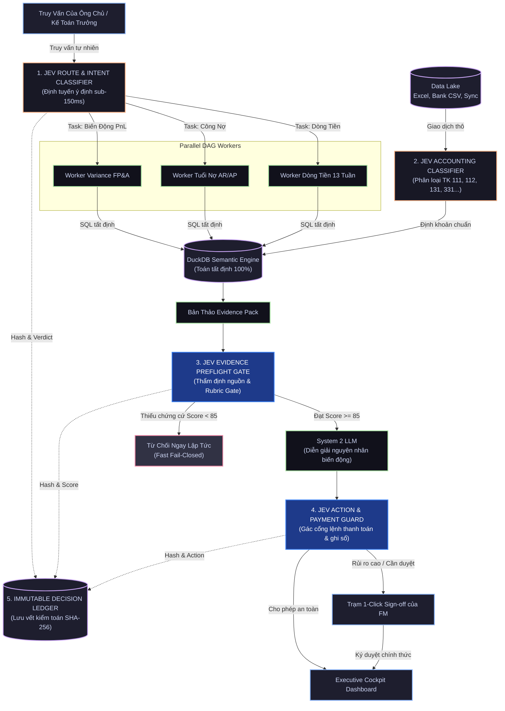

# Thiết Kế Chi Tiết: Tích Hợp Hệ Thống TypeSafe Jev (System 1) Vào Nền Tảng FinESO

> **Mã Tài Liệu:** `SDLC-ARCH-02-JEV-TYPESAFE`  
> **Dự Án:** FinESO (Financial Evident-Sufficient Orchestration)  
> **Mục Tiêu:** Định vị và thiết kế cơ chế nhúng sâu - rộng mô hình **TypeSafe Jev (System 1)** vào toàn bộ chu trình xử lý tài chính, đối soát bằng chứng và gác cổng an toàn cho doanh nghiệp.

---

## 1. Bối Cảnh Nghiệp Vụ & Động Lực Kiến Trúc

Trong tài liệu kiến trúc nền tảng [01.architecture-blueprint.md](01.architecture-blueprint.md), FinESO nhận diện **5 cạm bẫy cốt tử** khi đưa AI vào tài chính:
1. *Ảo giác số học* (Probabilistic LLM vs Deterministic Math).
2. *Độ trễ cao* (45–90s) do chuỗi tuần tự và bùng nổ token.
3. *Sổ sách trễ & dữ liệu bẩn* cần đối chiếu liên tục.
4. *Tâm lý phòng thủ của Kế toán trưởng (FM)* đối với các quyết định hộp đen.
5. *Group Chat vô kỷ luật* làm trôi ngữ cảnh kiểm toán.

### Giải Pháp Đột Phá: Kiến Trúc Tư Duy Kép (Dual-System Cognition)
Hệ thống kết hợp 2 tầng tư duy bổ trợ nhau theo nguyên lý của Daniel Kahneman:

```
┌────────────────────────────────────────────────────────────────────────┐
│                   HỆ THỐNG TƯ DUY KÉP TRONG FINESO                     │
├───────────────────────────────────┬────────────────────────────────────┤
│   SYSTEM 1: TYPESAFE JEV          │   SYSTEM 2: DEEPSEEK / GEMINI      │
│   (Tư duy phản xạ siêu tốc)       │   (Tư duy suy luận sâu sắc)        │
├───────────────────────────────────┼────────────────────────────────────┤
│ • Thời gian phản hồi: 100 - 200ms │ • Thời gian phản hồi: 3 - 15 giây  │
│ • Chi phí token: Cực thấp         │ • Chi phí token: Trung bình/Cao    │
│ • Cấu trúc: Typed Questions/Schema│ • Cấu trúc: Free-form text / JSON  │
│ • Nhiệm vụ:                       │ • Nhiệm vụ:                        │
│   - Phân loại ý định (Routing)    │   - Diễn giải biến động sâu sắc    │
│   - Gác cổng rủi ro (Guardrails)  │   - Đề xuất chiến lược tài chính   │
│   - Tiền kiểm định (Preflight)    │   - Soạn thảo bản tin điều hành    │
│   - Phân loại định khoản kế toán  │   - Tư vấn tối ưu cơ cấu nợ        │
└───────────────────────────────────┴────────────────────────────────────┘
```

---

## 2. Năm Trọng Điểm Jev Tham Gia Sâu - Rộng Vào FinESO



---

### Trọng Điểm 1: Định Tuyến Ý Định & Rã Việc DAG (L2 Decision Facade)
- **Vấn đề giải quyết**: Tránh gọi LLM lớn chỉ để phân loại xem người dùng đang hỏi về Dòng tiền, Tuổi nợ, hay Chi phí vượt ngân sách.
- **Cơ chế Jev**: Gửi câu hỏi của người dùng vào `/v1/systemone` với bộ câu hỏi định kiểu (Typed Schema Questions):
  ```json
  {
    "model": "jev-latest",
    "state": "Câu hỏi từ Ông chủ: 'Tháng này tiền về có đủ trả nợ ngân hàng ngày 25 không?'",
    "questions": {
      "target_domain": {
        "type": "choice",
        "choices": ["cashflow_forecast", "debt_aging", "variance_pnl", "payment_signoff"]
      },
      "urgency_level": {
        "type": "choice",
        "choices": ["routine", "urgent_cash_deficit", "critical_liquidity"]
      },
      "requires_human_approval": {
        "type": "noul",
        "instructions": "Có yêu cầu ký duyệt xuất tiền hoặc cam kết pháp lý không?"
      }
    }
  }
  ```
- **Hiệu quả**: Định tuyến chuẩn xác trong vòng **$120\text{ms}$**, chỉ kích hoạt đúng worker cần thiết.

---

### Trọng Điểm 2: Gác Cổng Hành Động Tài Chính (Action & Payment Guard)
- **Vấn đề giải quyết**: Ngăn chặn AI tự ý thực hiện các hành động rủi ro cao (ghi sổ cái chính thức, sửa dữ liệu gốc, phát lệnh chuyển khoản).
- **Cơ chế Jev**: Mỗi khi một tác vụ nhạy cảm được yêu cầu:
  1. `deny`: Lệnh chứa các từ khóa cấm hoặc hành vi phá hoại $\to$ Chặn ngay.
  2. `allow`: Thao tác đọc dữ liệu, tính toán tạm thời $\to$ Cho phép tức thì.
  3. `ask`: Thao tác xuất tiền $> 50.000.000\text{ VND}$ hoặc ghi đè sổ cái $\to$ Bắt buộc dừng lại và chuyển sang Human-in-the-loop (FM Sign-off).

---

### Trọng Điểm 3: Tiền Kiểm Định Gói Chứng Cứ (Evidence-Sufficiency Preflight)
- **Vấn đề giải quyết**: Tuân thủ triệt để **Bất biến 1 & 4** (*No Evidence $\to$ No Claim*, *Rubric Gate $\ge 85$*).
- **Cơ chế Jev**: Trước khi gửi bản thảo số liệu sang mô hình System 2 (DeepSeek) để viết lời bình:
  - Jev thực hiện thẩm định nhanh cấu trúc:
    - Mọi con số có tọa độ ô Excel (`Sheet1!D15`) hoặc mã giao dịch ngân hàng đính kèm không?
    - Số liệu có khớp $100\%$ với kết quả truy vấn từ DuckDB không?
  - Nếu điểm sơ bộ $< 85$: **Fast Fail-Closed** ngay lập tức trong $150\text{ms}$, yêu cầu kế toán bổ sung chứng từ, tiết kiệm $100\%$ chi phí token của LLM System 2.

---

### Trọng Điểm 4: Phân Loại Giao Dịch & Hóa Đơn Kế Toán (Accounting Classifier)
- **Vấn đề giải quyết**: Hàng ngàn dòng sao kê ngân hàng và hóa đơn bán lẻ/đầu vào cần được phân loại vào đúng tài khoản theo chuẩn Kế toán Việt Nam (Thông tư 200/133).
- **Cơ chế Jev**: Phân tích nội dung chuyển khoản thô (ví dụ: *"Thanh toan tien thue van phong thang 10"*):
  - Phân loại tài khoản nợ/có: `TK 6422` (Chi phí quản lý doanh nghiệp).
  - Trả về độ tin cậy định lượng (`confidence score` từ $0.00$ đến $1.00$).
  - Nếu `confidence >= 0.90`: Tự động định khoản nháp.
  - Nếu `confidence < 0.90`: Đánh dấu cờ cần Kế toán viên đối chiếu bằng tay.

---

### Trọng Điểm 5: Sổ Cái Ra Quyết Định Bất Biến (Immutable Decision Ledger)
- **Cơ chế lưu vết kiểm toán**: Mọi lần triệu gọi Jev đều được lưu vào cơ sở dữ liệu `DecisionLedger`:
  - `jev_request_hash`: Mã băm SHA-256 của yêu cầu đầu vào.
  - `jev_response_json`: Câu trả lời định kiểu có chữ ký số.
  - `latency_ms_jev`: Thời gian phản hồi thực tế (thường từ $80 - 180\text{ms}$).
  - `resolver_winner`: Thành phần đưa ra phán quyết cuối cùng (`l0_resolver`, `route_jev`, `jev_guard_ask`).
- **Lợi ích**: Khi cơ quan thuế hoặc kiểm toán độc lập vào kiểm tra, doanh nghiệp chứng minh được tính minh bạch và nguồn gốc của từng quyết định tài chính.

---

## 3. Cập Nhật Cấu Hình Hệ Thống

Để kích hoạt chế độ **Jev Active** cho FinESO, các tệp cấu hình được thiết lập:
- Trong [.harness/decision-policy.json](file:///Users/thangs2net/Workspaces/FinESO/.harness/decision-policy.json):
  ```json
  "jev": {
    "mode": "active",
    "model": "jev-latest",
    "thresholds": {
      "auto_approve": 0.90,
      "confirm_required": 0.50
    }
  }
  ```
- Môi trường thực thi: Tích hợp tệp khóa `installation/typesafe/typesafe.env` với endpoint chính thức `https://api.typesafe.ai`.
