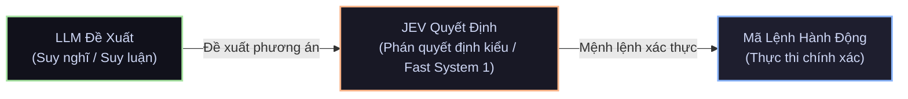

# 9 Cách Dùng JEV Trong Agent

> **Triết lý cốt lõi:**  
> *LLM suy nghĩ, Jev quyết định, mã lệnh hành động — chín điểm can thiệp tạo khác biệt cho một agent.*  
>
> **Vòng lặp tổng quát:**  
> `LLM đề xuất` $\longrightarrow$ `Jev quyết định` $\longrightarrow$ `Mã lệnh hành động`

---

## Tổng Quan Kiến Trúc Vòng Lặp



---

## Chi Tiết 9 Điểm Can Thiệp Của JEV

### 1. Điều phối mô hình (Model Routing)
* **Loại câu hỏi Jev:** `Lựa chọn` (Choice)
* **Sơ đồ luồng:**
  ```
  [Agent] ──> [Jev] ──┬──> [LLM nhỏ]
                      ├──> [LLM vừa]
                      └──> [LLM lớn]
  ```
* **Cơ chế:** Phân tích độ phức tạp của bước tác vụ để chọn mô hình LLM tối ưu nhất về chi phí và năng lực.
* **Quy tắc:** Mô hình rẻ nhất vẫn làm được bước này.
* **Ví dụ phán quyết:** `chọn: LLM vừa 0,77`

---

### 2. Hàng rào an toàn (Input Safety Guardrail)
* **Loại câu hỏi Jev:** `Noul` (Xác suất định lượng $[0, 1]$)
* **Sơ đồ luồng:**
  ```
  [Đầu vào] ──> [Jev] ──┬──> [Agent] (Cho qua nếu an toàn)
                        └──> [Chặn] (Nếu độc hại / Prompt Injection)
  ```
* **Cơ chế:** Kiểm tra dữ liệu đầu vào trước khi nạp vào context của Agent để phòng chống prompt injection, dữ liệu rác hoặc độc hại.
* **Quy tắc:** Sàng lọc những gì agent đọc trước khi hành động.
* **Ví dụ phán quyết:** `tiêm nhiễm 0,03 > cho qua`

---

### 3. Kiểm soát gọi công cụ (Tool Call Guard)
* **Loại câu hỏi Jev:** `Lựa chọn` (Choice)
* **Sơ đồ luồng:**
  ```
  [Agent gọi công cụ] ──> [Jev] ──┬──> [Cho phép]
                                  ├──> [Hỏi bạn] (Human-in-the-loop)
                                  └──> [Từ chối]
  ```
* **Cơ chế:** Kiểm tra tham số và độ nhạy cảm của từng lệnh gọi công cụ (shell command, file edit, API call) trước khi cho phép hệ thống thực thi.
* **Quy tắc:** Kiểm tra mọi lệnh gọi công cụ trước khi chạy.
* **Ví dụ phán quyết:** `npm publish > hỏi 0,62`

---

### 4. Phân loại hộp thư (Inbox Triage)
* **Loại câu hỏi Jev:** `Lựa chọn` (Choice)
* **Sơ đồ luồng:**
  ```
  [Hộp thư] ──> [Jev] ──┬──> [Trả lời ngay]
                        ├──> [Để sau]
                        └──> [Lưu trữ]
  ```
* **Cơ chế:** Lọc và phân luồng các thông điệp, email, sự kiện đến để agent ưu tiên xử lý việc quan trọng, tránh bùng nổ token ngữ cảnh.
* **Quy tắc:** Agent chỉ mở những gì cần phản hồi.
* **Ví dụ phán quyết:** `lưu trữ 0,93`

---

### 5. Xếp hạng lại (Reranking Documents)
* **Loại câu hỏi Jev:** `Noul x 30` (Đánh giá xác suất song song cho tập dữ liệu)
* **Sơ đồ luồng:**
  ```
  [Agent] ──┬──> [Jev] ──> [Điểm số từng đoạn: 0.91, 0.64, 0.22, 0.05]
  [Tài liệu 30 đoạn] ─┘      │
                             └──> [Trả 2 mục đầu điểm cao nhất lại cho Agent]
  ```
* **Cơ chế:** Chấm điểm mức độ liên quan và độ tin cậy của hàng chục đoạn tài liệu được truy xuất (RAG), sau đó chỉ trích xuất các đoạn tốt nhất đưa vào context.
* **Quy tắc:** Chấm điểm các đoạn, đưa agent 2 đoạn tốt nhất.
* **Ví dụ phán quyết:** `2 đoạn tốt nhất trong 3 đoạn > agent`

---

### 6. Đánh giá LLM (LLM Output Evaluation)
* **Loại câu hỏi Jev:** `Điểm số` (Score)
* **Sơ đồ luồng:**
  ```
  [Bản nháp của Agent] ──> [Jev] ──> [Vạch điểm: 4/5] ──> [Triển khai]
         ▲                                   │
         └──────── (Nếu chưa đạt) ───────────┘
  ```
* **Cơ chế:** Kiểm tra và chấm điểm bản nháp (output) của LLM theo bộ tiêu chuẩn định sẵn trước khi triển khai hoặc gửi cho người dùng.
* **Quy tắc:** Chấm đầu ra, chưa đạt thì lặp lại.
* **Ví dụ phán quyết:** `điểm 4/5 > triển khai`

---

### 7. Gán nhãn hàng loạt (Batch Classification / Tagging)
* **Loại câu hỏi Jev:** `Lựa chọn` (Choice) chạy song song
* **Sơ đồ luồng:**
  ```
  [Các dòng dữ liệu] ──> ┌──> [Jev] ──┐
                         ├──> [Jev] ──┼──> [Đã gán nhãn: lỗi / hỏi / k-xd / khác] ──> [Agent]
                         └──> [Jev] ──┘
  ```
* **Cơ chế:** Phân tích và gán nhãn đồng loạt hàng trăm dòng dữ liệu bảng hoặc sự kiện theo các nhãn phân loại chuẩn.
* **Quy tắc:** Tung một câu hỏi trên cả bảng dữ liệu lớn.
* **Ví dụ phán quyết:** `lô 3/8 -> agent nhận số lượng`

---

### 8. Điều khiển thời gian thực (Real-time Control Loop)
* **Loại câu hỏi Jev:** `Lựa chọn` (Choice) theo chu kỳ tick
* **Sơ đồ luồng:**
  ```
  [Agent] ──> [Mục tiêu] ──────────┐
                                   ▼
  [Trạng thái trò chơi / bot] ──> [Jev] ──> [Hành động]
         ▲                                     │
         └────────── (Vòng lặp mỗi nhịp) ──────┘
  ```
* **Cơ chế:** Đọc trạng thái liên tục ở mỗi nhịp vòng lặp (game, bot phản ứng, bot giao dịch tài chính) và ra quyết định hành động tức thì.
* **Quy tắc:** Game, bot, vòng lặp giao dịch; quyết định ở mỗi nhịp.
* **Ví dụ phán quyết:** `mỗi nhịp > đọc trạng thái`

---

### 9. Cổng độ tin cậy (Confidence Gate)
* **Loại câu hỏi Jev:** `Độ tin cậy` (Confidence Metric)
* **Sơ đồ luồng:**
  ```
  [Mục tiêu của Agent] ──> [Jev] ──┬──> [Hành động]    (Độ tin cậy > 0,9)
                                   ├──> [Xác nhận]     (Độ tin cậy 0,5 đến 0,9)
                                   └──> [Con người]    (Độ tin cậy < 0,5)
  ```
* **Cơ chế:** Lập trình các ngưỡng tin cậy cứng trong code để quyết định mức độ tự chủ của Agent: tự động hành động, yêu cầu xác nhận hay bàn giao cho con người.
* **Quy tắc:** Mã của bạn đặt ngưỡng, không phải LLM.
* **Ví dụ phán quyết:** `độ tin cậy 0,96 > hành động`

---

## Bảng So Sánh 9 Ứng Dụng Trong FinESO

| STT | Điểm can thiệp Jev | Kiểu phán quyết Jev | Áp dụng trong FinESO |
|:---:|---|---|---|
| **1** | **Điều phối mô hình** | `Choice` | Phân luồng câu hỏi nghiệp vụ đơn giản sang model nhẹ, tác vụ đối soát nặng sang DeepSeek/Gemini. |
| **2** | **Hàng rào an toàn** | `Noul` | Sàng lọc dữ liệu hóa đơn, sao kê lạ trước khi nạp vào sổ cái để tránh prompt injection tài chính. |
| **3** | **Kiểm soát gọi công cụ** | `Choice` | Gác cổng lệnh shell nhạy cảm (`git push`, migration, lệnh xóa dữ liệu data-lake). |
| **4** | **Phân loại hộp thư** | `Choice` | Triage hóa đơn đến: thanh toán ngay, lưu trữ tra cứu, hoặc chuyển Kế toán trưởng duyệt. |
| **5** | **Xếp hạng lại** | `Noul x N` | Lọc 30 điều khoản hợp đồng/luật kế toán liên quan, chỉ trích 2 điều khoản sát nhất cho Agent. |
| **6** | **Đánh giá LLM** | `Score` | Kiểm tra báo cáo tài chính trước khi xuất PDF: đủ đối soát 4 chiều chưa (đạt $\ge 4/5$ mới xuất). |
| **7** | **Gán nhãn hàng loạt** | `Choice` song song | Phân loại hàng ngàn dòng sao kê ngân hàng vào các tài khoản kế toán (TK 111, 112, 642, 131). |
| **8** | **Điều khiển thời gian thực** | `Choice` mỗi nhịp | Vòng lặp đồng bộ dữ liệu ngân hàng thời gian thực: phát hiện biến động số dư là kích hoạt đối soát. |
| **9** | **Cổng độ tin cậy** | `Confidence` | Khớp hóa đơn tự động: độ tin cậy $> 0.90$ tự ghi sổ, $0.50 - 0.90$ cần duyệt, $< 0.50$ báo thủ công. |
