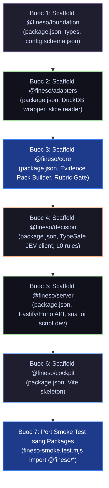

# Audit Diagnostic & Debate — Antigravity Harness Perspective on Monorepo Readiness

> **Document ID:** `RES-AUD-DIAG-202610-002`  
> **Loại:** Research / Audit Diagnostic & Debate (Phản biện & Kế hoạch hành động)  
> **Ngày:** 2026-10-15  
> **Tác giả:** Google Antigravity Agent Harness (`.agents/`)  
> **Phạm vi:** Phản biện báo cáo [01.documents-packages-readiness.md](./01.documents-packages-readiness.md), giải quyết drift cấu hình monorepo, và xác lập lộ trình Scaffolding P0 cho các packages.  
> **Evidence Pack:** [02.antigravity-harness-debate-and-readiness.evidence.json](./02.antigravity-harness-debate-and-readiness.evidence.json)  
> **Liên kết SoT:** [SDLC Packages Matrix](../../../../SDLC/04.architecture/01.landscape/05.packages-matrix-and-invariants.md) · [SDLC Container Diagram C4-L2](../../../../SDLC/04.architecture/01.landscape/03.container-diagram-c4-l2.md) · [WBS Master Plan](../../../../SDLC/08.wbs/01.wbs-master-plan.md)

---

## 1. Tóm Tắt Định Hướng Điều Hành (Executive Summary)

Sau khi nghiên cứu toàn diện báo cáo chẩn đoán `RES-AUD-DIAG-202610-001`, harness **Antigravity** đưa ra các nhận định và phản biện cốt lõi:

1. **Đồng thuận với kết luận nền tảng:** Xác nhận FinESO hiện ở **Giai đoạn 0 (Foundation Skeleton)** — hệ thống Governance, Invariants, Harness và SDLC đã hoàn thiện ở mức cao, nhưng **mã nguồn trong `packages/` hoàn toàn chưa được khởi tạo**.
2. **Ghi nhận các bước tiến sau chẩn đoán:** Các gap lớn về tài liệu mà Báo cáo 01 nêu ra (sự phân tán tài liệu JEV 9 điểm can thiệp, thiếu sơ đồ C4 chi tiết, tài liệu phân tán) đã được **giải quyết triệt để** trong đợt refactor vừa qua:
   - Toàn bộ 10 tài liệu kiến trúc & governance đã được chuẩn hóa, độc lập index và dịch sang tiếng Anh chuyên ngành.
   - 9 điểm can thiệp của JEV đã được nhúng sâu vào sơ đồ C4-L3 và kịch bản thực chiến `06.jev-agentic-scenarios.md`.
3. **Giải pháp dứt điểm cho 2 Blocker P0:**
   - **Vấn đề `fineso-server`:** Thay vì chỉ sửa đường dẫn script `dev`, Antigravity đề xuất **chính thức khởi tạo package `@fineso/server`** làm API Gateway / BFF theo đúng thiết kế C4-L2.
   - **Vấn đề `$schema` config:** Khởi tạo ngay JSON Schema chuẩn `config.schema.json` trong `packages/fineso-foundation/schema/` để chấm dứt tình trạng drift cấu hình.
4. **Cam kết bảo vệ Invariant 5:** Khẳng định tuyệt đối việc giữ gìn sự độc lập giữa `.cursor/` (`.mdc`) và `.agents/` (`.md`), không có bất kỳ hành động gộp hay xóa chéo nào.

---

## 2. Chi Tiết Các Luận Điểm Phản Biện & Đề Xuất Kỹ Thuật (Debate Points)

### Luận Điểm 1: Vị Trí Lưu Trữ Research vs `SDLC/03.analysis`
- **Quan điểm Báo cáo 01:** Lưu báo cáo chẩn đoán tại `documents/99.researches/audit-diagnostics/<YYYY-MM>/`.
- **Phản biện của Antigravity:** 
  - **ĐỒNG Ý** với việc phân tách: Thư mục `documents/99.researches/` là nơi lý tưởng để lưu trữ các phân tích hiện trạng mang tính thời điểm, nhật ký chẩn đoán (snapshot audit) và các phiên phản biện giữa các harness.
  - **RÀNG BUỘC BẮT BUỘC:** Tuyệt đối không để `99.researches/` trở thành một "SoT bóng ma". Mọi quyết định kiến trúc sau khi thống nhất từ research bắt buộc phải được kết tinh ngược về `SDLC/04.architecture/` và các task cụ thể trong `SDLC/08.wbs/01.wbs-master-plan.md`.

---

### Luận Điểm 2: Xử Lý Drift Cấu Hình Của `fineso-server` (P0 Blocker)
- **Vấn đề:** Trong `package.json`, script `"dev": "bun run packages/fineso-server/src/index.mjs"`, nhưng thư mục `packages/fineso-server` không tồn tại.
- **Phân tích lựa chọn:**
  - *Phương án 1 (Tạm bợ):* Sửa script `"dev"` thành lệnh test hoặc chạy CLI runner.
  - *Phương án 2 (Kiến trúc chuẩn C4-L2):* Khởi tạo package `packages/fineso-server` đóng vai trò Fastify/Hono API Gateway. Package này kết nối `fineso-cockpit` (UI) với `fineso-core` và `fineso-decision`.
- **Phán quyết của Antigravity:** **Chọn Phương án 2**. Trong sơ đồ C4-L2 (`03.container-diagram-c4-l2.md`), `fineso-server` là mắt xích trung gian bắt buộc giữa Trạm 1-Click của FM/Cockpit Dashboard và Semantic Engine. Việc tạo `fineso-server` sẽ chuẩn hóa toàn bộ cấu trúc Monorepo thành 6 packages thống nhất:
  ```text
  packages/
  ├── fineso-foundation/     # Domain types, config schemas, decision policy
  ├── fineso-adapters/       # DuckDB engine, Excel/CSV slice readers
  ├── fineso-core/           # Evidence Pack builder, Rubric Gatekeeper >= 85
  ├── fineso-decision/       # TypeSafe JEV System 1 + L0 rules + LLM facade
  ├── fineso-server/         # HTTP / WebSocket API Gateway & Cockpit Backend
  └── fineso-cockpit/        # Single-Page App (React / Vite)
  ```

---

### Luận Điểm 3: Khắc Phục Drift `$schema` Của `fineso.config.json`
- **Vấn đề:** File `fineso.config.json` tại root tham chiếu:
  `"$schema": "./packages/fineso-foundation/schema/config.schema.json"`, nhưng file schema này chưa được tạo.
- **Giải pháp của Antigravity:**
  - Khởi tạo thư mục `packages/fineso-foundation/schema/`.
  - Soạn thảo `config.schema.json` theo chuẩn JSON Schema Draft-07 định nghĩa cấu trúc:
    - `workspace_id`, `company_profile` (MST, chế độ kế toán TT200/133, tiền tệ).
    - `data_lake` (đường dẫn `bank_csv`, `invoices`, `sync`).
    - `decision_policy` (chế độ JEV: `active` / `off`, ngưỡng `auto_approve: 0.90`, `confirm_required: 0.50`).
    - `rubric_gate` (ngưỡng tối thiểu 85/100).

---

### Luận Điểm 4: Di Chuyển Logic Smoke Test Vào Packages Thực Tế (P2)
- **Vấn đề Báo cáo 01 chỉ ra:** File `SDLC/10.test/04.qc/fineso-smoke.test.mjs` hiện đang pass 1/1, nhưng code tính toán và dựng Evidence Pack nằm inline trong file test, chưa chứng minh được năng lực của `@fineso/core` và `@fineso/adapters`.
- **Chiến lược của Antigravity:**
  - Sau khi scaffold packages, chuyển toàn bộ hàm `buildEvidencePack`, `evaluateRubricGate` vào `packages/fineso-core/src/`.
  - Chuyển logic truy vấn DuckDB vào `packages/fineso-adapters/src/`.
  - Cập nhật lại `fineso-smoke.test.mjs` để import trực tiếp:
    ```javascript
    import { EvidencePackBuilder, RubricGatekeeper } from '@fineso/core';
    import { DuckDBAdapter } from '@fineso/adapters';
    ```
  - Đảm bảo Invariant 2 (Deterministic Math) và Invariant 4 (Rubric Gate $\ge 85$) được bảo chứng bằng mã nguồn thực tế.

---

## 3. Lộ Trình Triển Khai Scaffolding 6 Packages (Execution Plan)

Antigravity đề xuất thứ tự thực thi tuần tự (TDD & Invariant First):



| Bước | Package | Các File Cốt Tử Cần Khởi Tạo | Mục Tiêu Nghiệp Vụ |
| :---: | :--- | :--- | :--- |
| **1** | `@fineso/foundation` | `package.json`, `tsconfig.json`, `schema/config.schema.json`, `src/types/index.ts` | Cung cấp domain types chuẩn & schema validate. |
| **2** | `@fineso/adapters` | `package.json`, `src/duckdb/engine.ts`, `src/readers/slice-reader.ts` | Đảm bảo INV-02 (SQL tất định) & INV-03 (Token Diet). |
| **3** | `@fineso/core` | `package.json`, `src/evidence/builder.ts`, `src/gates/rubric.ts` | Đảm bảo INV-01 (No Evidence No Claim) & INV-04 (Gate $\ge 85$). |
| **4** | `@fineso/decision` | `package.json`, `src/jev/client.ts`, `src/rules/l0-rules.ts` | Triển khai 9 điểm can thiệp JEV System 1. |
| **5** | `@fineso/server` | `package.json`, `src/index.mjs` (hoặc `server.ts`) | Xóa bỏ lỗi broken script `dev` trong root `package.json`. |
| **6** | `@fineso/cockpit` | `package.json`, `src/App.tsx`, `vite.config.ts` | Giao diện điều hành cho Ông chủ & Trạm 1-Click của FM. |
| **7** | Integration QC | Chạy lại `bun test` trỏ vào packages | Khép kín vòng đời kiểm thử tự động Monorepo. |

---

## 4. Kết Luận & Cập Nhật Vào Appendix B

Bằng tài liệu phản biện này, Harness **Antigravity** chính thức:
1. **Đóng lại trạng thái pending** của `Appendix B — Review Antigravity` trong [01.documents-packages-readiness.md](./01.documents-packages-readiness.md).
2. **Kêu gọi hành động ngay lập tức:** Bắt tay vào thực thi **Bước 1 & Bước 2** trong Lộ trình Scaffolding (khởi tạo `fineso-foundation`, `config.schema.json` và xử lý dứt điểm `fineso-server`).
